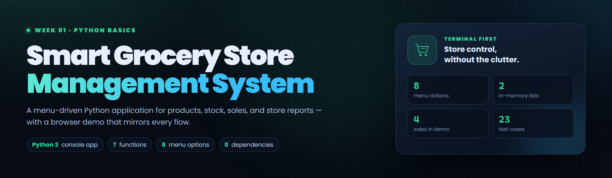
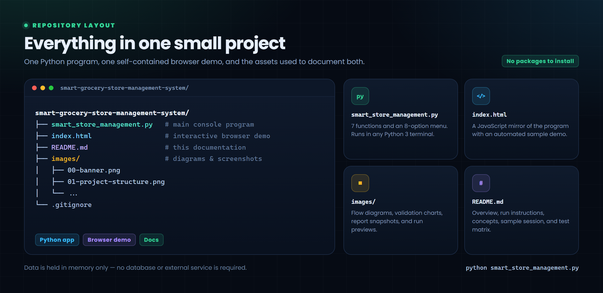
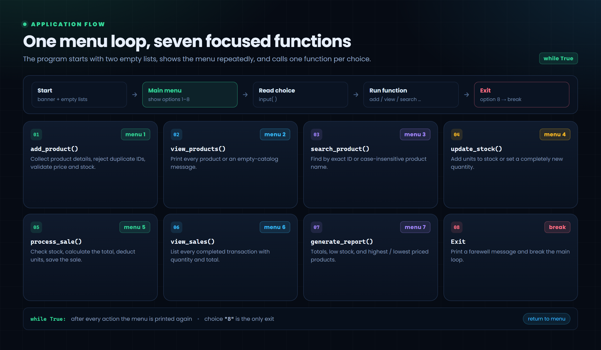
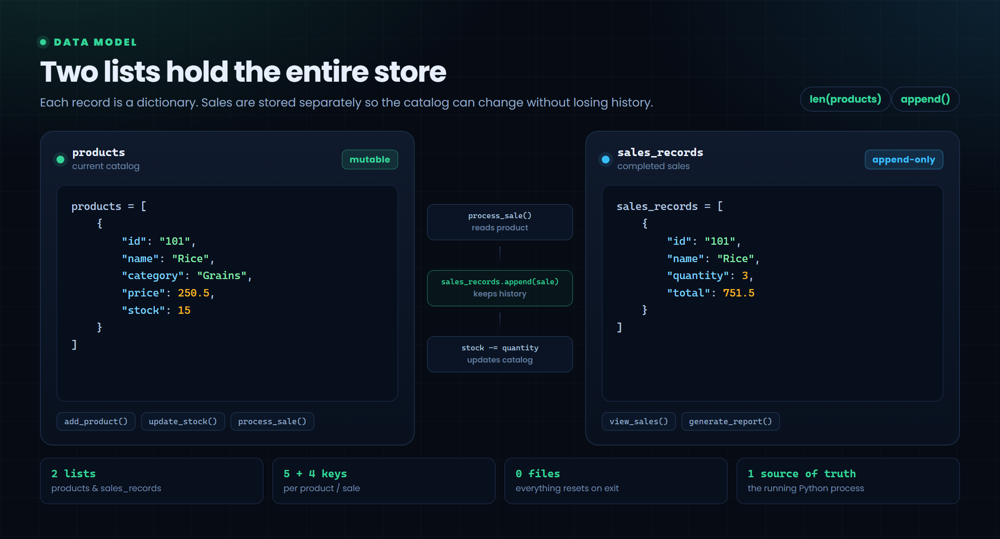
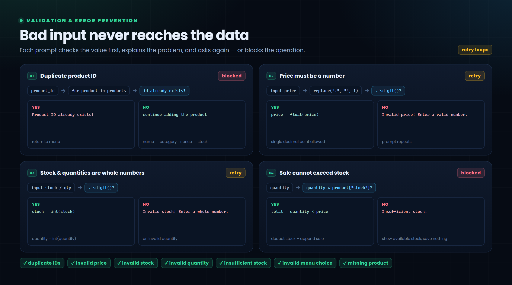
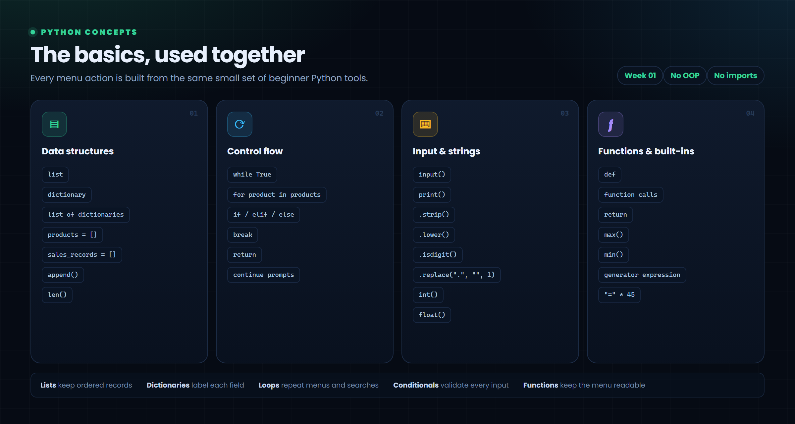
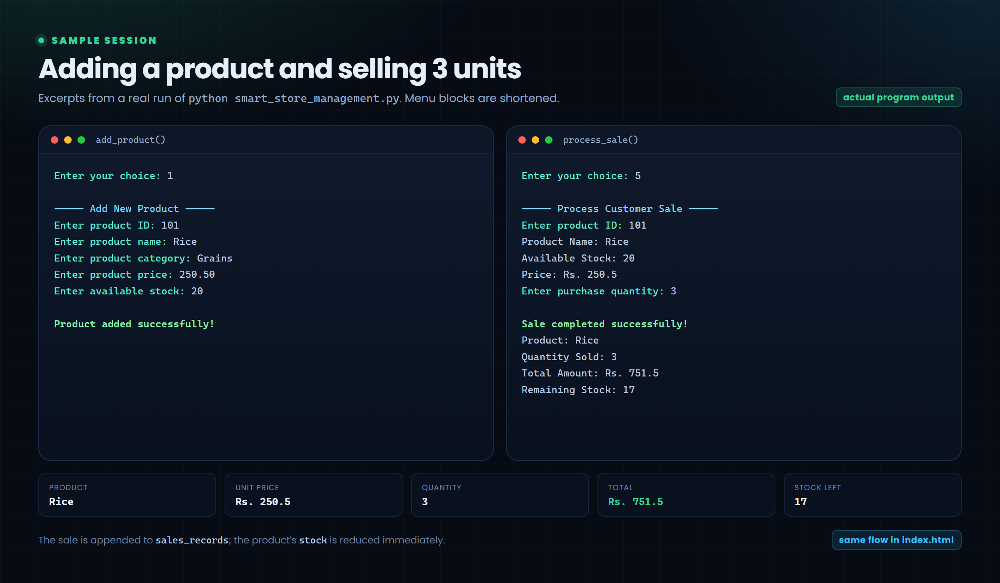
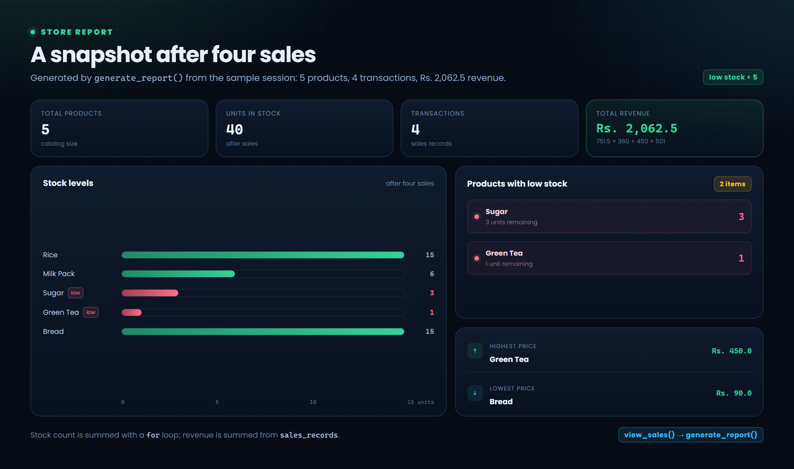
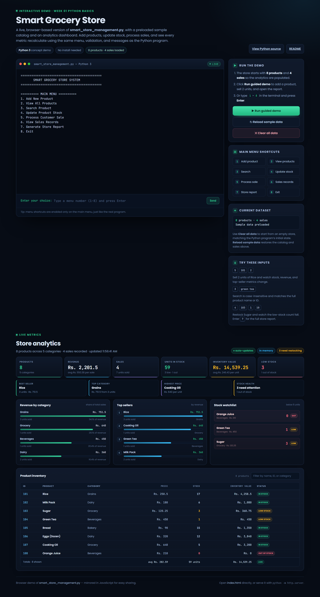
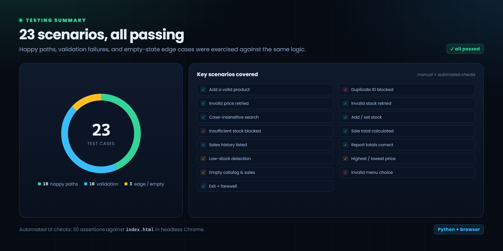

# Smart Grocery Store Management System

**Week 01 – Python Basics · Menu-driven console application**

A complete beginner Python project that runs a small grocery store from the terminal. Products are
stored as dictionaries inside a list, sales are recorded in a second list, and a `while True` loop keeps
the menu running until the user exits. The repository also includes a self-contained browser demo with
a preloaded sample catalog and a live analytics dashboard that mirrors the same menu, validation, and
report logic.

| Part | File | Purpose |
|---|---|---|
| Python application | `smart_store_management.py` | Full console program with 7 functions and 8 menu options |
| Browser demo | `index.html` | Interactive demo of the same flows, with no Python installation required |
| Documentation | `README.md` + `assets/` | Overview, diagrams, run instructions, sample session, and tests |

**Quick links:** [Project structure](#1-project-structure) ·
[How to run](#3-requirements-and-how-to-run) ·
[Sample run](#8-sample-run) ·
[Browser demo](#10-interactive-browser-demo) ·
[Test cases](#11-testing-summary)

---

## Table of contents

1. [Project structure](#1-project-structure)
2. [Overview](#2-overview)
3. [Requirements and how to run](#3-requirements-and-how-to-run)
4. [Program walkthrough](#4-program-walkthrough)
5. [Data model](#5-data-model)
6. [Validation and error prevention](#6-validation-and-error-prevention)
7. [Python concepts used](#7-python-concepts-used)
8. [Sample run](#8-sample-run)
9. [Store report explained](#9-store-report-explained)
10. [Interactive browser demo](#10-interactive-browser-demo)
11. [Testing summary](#11-testing-summary)
12. [Project checklist](#12-project-checklist)

---

## 1. Project structure



```text
smart-grocery-store-management-system/
├── smart_store_management.py   # main console program
├── index.html                  # interactive browser demo
├── README.md                   # this documentation
├── assets/                     # diagrams, charts and screenshots
│   ├── 00-banner.png
│   ├── 01-project-structure.png
│   ├── 02-program-flow.png
│   ├── 03-data-model.png
│   ├── 04-concepts-map.png
│   ├── 05-validation-flow.png
│   ├── 06-store-report.png
│   ├── 07-sample-session.png
│   ├── 08-browser-demo.png
│   └── 09-testing-summary.png
└── .gitignore
```

Only `smart_store_management.py` is required to run the Python program. `index.html` is optional and
provides the browser-based demo. The `assets/` folder is used only by this README.

---

## 2. Overview

The project simulates the daily operations of a small grocery store:

- **Catalog management** — add products with a unique ID, name, category, price, and stock.
- **Browse and search** — view the full catalog or search by exact ID or product name.
- **Stock control** — add units to an existing product or replace its stock quantity.
- **Sales** — sell a quantity, calculate the total, reduce stock, and store a sales record.
- **Reporting** — count products and transactions, sum stock and revenue, flag low stock, and find the
  highest and lowest priced products.

| At a glance | Value |
|---|---|
| Menu options | 8 |
| Functions | 7 |
| Data structures | 2 lists of dictionaries |
| Storage | In memory — resets when the program exits |
| External dependencies | None (standard Python only) |
| Browser demo | `index.html` |

The program is intentionally simple: it uses only the concepts covered in Week 01 — variables, lists,
dictionaries, functions, loops, conditionals, string methods, and input validation.

---

## 3. Requirements and how to run

### Requirements

- **Python 3.x** for the console application (`python --version` should work).
- **Any modern browser** for `index.html`.
- No third-party packages, virtual environment, or database is needed.

### Run the Python program

```bash
cd smart-grocery-store-management-system
python smart_store_management.py
```

On systems where `python` is not available, use:

```bash
python3 smart_store_management.py
```

1. Type a menu number (`1`–`8`) and press **Enter**.
2. Follow the prompts for the selected action.
3. Enter `8` to exit.

### Run the browser demo

```bash
# Option 1: open index.html directly in a browser
# Option 2: serve the folder locally
python -m http.server 8000
```

Then open <http://localhost:8000/index.html>.

> **Data note:** Both versions keep everything in memory. Closing the Python program resets its empty
> lists, refreshing the browser page reloads the sample dataset, and **Clear all data** empties the
> browser demo without a reload.

---

## 4. Program walkthrough



The Python file has three logical parts: two lists, seven functions, and one menu loop.

### 4.1 Setup

```python
products = []
sales_records = []
```

- `products` holds one dictionary per product.
- `sales_records` holds one dictionary per completed sale.

Both lists are created once when the program starts and live until it exits.

### 4.2 Functions

| Function | What it does |
|---|---|
| `add_product()` | Reads ID, name, category, price, and stock. Rejects duplicate IDs, validates price and stock, then appends a new dictionary to `products`. |
| `view_products()` | Prints every product, or `No products available.` when the catalog is empty. |
| `search_product()` | Finds a product by exact ID or case-insensitive name. Prints every match, or `Product not found.` |
| `update_stock()` | Finds a product by ID and either adds stock (`1`) or sets a new quantity (`2`). |
| `process_sale()` | Finds a product, checks the quantity against available stock, calculates the total, reduces stock, and appends a sale record. |
| `view_sales()` | Prints every sale with the product ID, name, quantity sold, and total amount. |
| `generate_report()` | Prints store totals, low-stock products (below 5 units), and the highest/lowest priced products. |

### 4.3 Main menu loop

```python
while True:
    print("\n========== MAIN MENU ==========")
    print("1. Add New Product")
    # ... options 2 to 7 ...
    print("8. Exit")

    choice = input("\nEnter your choice: ")

    if choice == "1":
        add_product()
    elif choice == "2":
        view_products()
    # ... options 3 to 7 ...
    elif choice == "8":
        print("\nThank you for using Smart Grocery Store System!")
        break
    else:
        print("Invalid choice! Please select between 1 and 8.")
```

The choice is compared as a **string** (`"1"` to `"8"`). After every action the menu is printed again.
Only option `8` breaks the loop.

---

## 5. Data model



### Products

Each product is a dictionary with five keys:

```python
{
    "id": "101",
    "name": "Rice",
    "category": "Grains",
    "price": 250.5,
    "stock": 15
}
```

| Key | Type | Meaning |
|---|---|---|
| `id` | string | Unique product identifier |
| `name` | string | Product name |
| `category` | string | Product group, e.g. Grains or Dairy |
| `price` | float | Price in rupees |
| `stock` | integer | Units currently available |

### Sales

Each sale is appended to `sales_records` after a successful transaction:

```python
{
    "id": "101",
    "name": "Rice",
    "quantity": 3,
    "total": 751.5
}
```

The sale stores the product ID and name at the time of purchase, so the sales history stays readable
even if the catalog changes later. The product's `stock` is reduced by `quantity` during the same
operation.

---

## 6. Validation and error prevention



Every input is checked before it is stored. Invalid input is explained and either retried or blocked.

| Check | Rule | Message / behaviour |
|---|---|---|
| Duplicate product ID | Loop through `products` and compare `product["id"]` | `Product ID already exists!` then return to the menu |
| Price format | `price.replace(".", "", 1).isdigit()` | `Invalid price! Enter a valid number.` and ask again |
| Stock format | `stock.isdigit()` | `Invalid stock! Enter a whole number.` and ask again |
| Stock update quantity | `quantity.isdigit()` | `Invalid quantity!`; the menu returns |
| Sale quantity format | `quantity.isdigit()` | `Invalid quantity! Enter numbers only.` |
| Sale quantity range | `quantity <= product["stock"]` | `Insufficient stock!` plus the available stock; nothing is saved |
| Zero sale quantity | `quantity <= 0` after `isdigit()` | `Quantity must be greater than zero.` |
| Search | ID equals the input or name matches ignoring case | `Product not found.` when there is no match |
| Missing product | Product ID not found in `products` | `Product not found.` |
| Menu choice | Must be exactly `"1"`–`"8"` | `Invalid choice! Please select between 1 and 8.` |

### Accepted and rejected input examples

| Prompt | Accepted | Rejected |
|---|---|---|
| Price | `250`, `250.50`, `.5` | `abc`, `-5`, `12.5.5` |
| Stock | `20`, `0` | `-5`, `ten`, `2.5` |
| Sale quantity | `1`, `3`, `10` | `abc`, `-1` |
| Menu choice | `1` … `8` | `0`, `9`, `abc` |

> **Search behaviour:** search is an exact match, not a partial search. `Rice` and `RICE` both find the
> product named `Rice`, but `Ric` does not.

---

## 7. Python concepts used



| Concept | Where it appears | Example from the program |
|---|---|---|
| **List** | Catalog and sales history | `products = []`, `sales_records = []` |
| **Dictionary** | One product or sale record | `{"id": "101", "name": "Rice", ...}` |
| **List of dictionaries** | Main data model | `products.append(new_product)` |
| **`append()`** | Adding products and sales | `sales_records.append(sale)` |
| **`len()`** | Empty checks and totals | `len(products)`, `len(sales_records)` |
| **Functions** | One function per menu action | `def add_product():` |
| **`return`** | Exit a function early | Duplicate ID exits `add_product()` |
| **`while True`** | Main menu and validation retries | `while True:` around the menu |
| **`for` loop** | Searching and summing | `for product in products:` |
| **`if` / `elif` / `else`** | Menu choices and validation | `if choice == "1":` |
| **`break`** | Leave a loop | Option `8` breaks the main loop |
| **`input()` / `print()`** | All interaction | `input("Enter product ID: ")` |
| **`int()` / `float()`** | Convert validated text | `int(stock)`, `float(price)` |
| **`.isdigit()`** | Whole-number validation | `quantity.isdigit()` |
| **`.replace()`** | Allow one decimal point | `price.replace(".", "", 1)` |
| **`.strip()` / `.lower()`** | Search normalisation | `input(...).strip()`, `.lower()` |
| **`max()` / `min()`** | Price extremes | `max(product["price"] for product in products)` |
| **Generator expression** | Feed prices to `max`/`min` | `(product["price"] for product in products)` |
| **String repetition** | Banner separators | `"=" * 45` |

The code deliberately avoids classes, files, and external libraries so that the whole program can be
read and explained line by line.

---

## 8. Sample run



### 8.1 Products added

| ID | Name | Category | Price | Stock |
|---|---|---|---|---|
| `101` | Rice | Grains | Rs. 250.50 | 20 |
| `102` | Milk Pack | Dairy | Rs. 180.00 | 8 |
| `103` | Sugar | Grocery | Rs. 120.25 | 3 |
| `104` | Green Tea | Beverages | Rs. 450.00 | 2 |
| `105` | Bread | Bakery | Rs. 90.00 | 15 |

### 8.2 Sales recorded

| Product | Quantity | Unit price | Total | Stock after sale |
|---|---|---|---|---|
| Rice | 3 | Rs. 250.5 | Rs. 751.5 | 17 |
| Milk Pack | 2 | Rs. 180.0 | Rs. 360.0 | 6 |
| Green Tea | 1 | Rs. 450.0 | Rs. 450.0 | 1 |
| Rice | 2 | Rs. 250.5 | Rs. 501.0 | 15 |

After four sales, the catalog contains **5 products**, **40 units**, **4 transactions**, and
**Rs. 2,062.5** in revenue.

### 8.3 Store report output

Menu blocks are omitted here; the values below are from a real run.

```text
========== STORE REPORT ==========
Total Products: 5
Total Available Stock: 40
Total Sales Transactions: 4
Total Revenue: Rs. 2062.5

Products with Low Stock:
Sugar - 3 units
Green Tea - 1 units

Product with Highest Price:
Green Tea - Rs. 450.0

Product with Lowest Price:
Bread - Rs. 90.0
==================================
```

> The browser demo seeds **4 of these sales** (Rice ×3, Milk Pack ×2, Green Tea ×1, Cooking Oil ×1), so
> its initial revenue is `Rs. 2,201.5` rather than `Rs. 2,062.5`. Stock and product counts follow the
> same arithmetic; see [Section 10](#10-interactive-browser-demo) for the exact seed values.

The same data is visualised in the next section.

---

## 9. Store report explained



| Report line | How it is calculated | Sample value |
|---|---|---|
| `Total Products` | `len(products)` | `5` |
| `Total Available Stock` | Sum of every `product["stock"]` with a `for` loop | `40` |
| `Total Sales Transactions` | `len(sales_records)` | `4` |
| `Total Revenue` | Sum of every `sale["total"]` with a `for` loop | `Rs. 2062.5` |
| `Products with Low Stock` | Every product where `stock < 5` | Sugar (3), Green Tea (1) |
| `Product with Highest Price` | `max(product["price"] ...)` then list all matches | Green Tea — Rs. 450.0 |
| `Product with Lowest Price` | `min(product["price"] ...)` then list all matches | Bread — Rs. 90.0 |

If several products share the highest or lowest price, **all of them are printed**. When the catalog is
empty, the report prints `No products available for price comparison.` and the low-stock section prints
`No products with low stock.`

---

## 10. Interactive Browser Demo



`index.html` recreates the terminal experience in the browser. It is a JavaScript reimplementation, not
the Python file running in the browser — this keeps it completely self-contained and easy to share.

The demo starts with a **sample dataset of 8 products and 4 sales** so the analytics are populated from
the first second. The seeded sales are a subset of the session in [Section 8](#8-sample-run) — Rice,
Milk Pack, Green Tea, and Cooking Oil — which is why its revenue is `Rs. 2,201.5` instead of
`Rs. 2,062.5`. Use **Clear all data** at any time to start from an empty store, exactly like the
Python program.

### Run the demo

**Option A — open the file directly**

1. Open the project folder.
2. Double-click `index.html` (or right-click → **Open with** → your browser).

**Option B — use a local web server**

```bash
python -m http.server 8000
```

Then open <http://localhost:8000/index.html>.

**Option C — GitHub Pages**

If Pages is enabled for the repository, the demo is available at:

```text
https://<your-username>.github.io/smart-grocery-store-management-system/
```

### What the demo includes

- The same 8-option menu, prompts, validation messages, and report calculations.
- A preloaded **sample dataset**: 8 products across 5 categories and 4 seeded sales.
- An automated **Run guided demo** button that adds *Organic Honey*, sells 2 units, and generates the
  report — ending with 9 products, 5 sales, and Rs. 3,901.5 revenue.
- **Main menu shortcut** buttons for options `1`–`8`.
- **Reload sample data** and **Clear all data** controls.
- A **filterable inventory table** that searches product name, ID, or category.

### Live analytics dashboard

Every add, stock update, and sale recalculates the dashboard in the same animation frame, so the
numbers always match the terminal output.

| KPI | Calculation | Seed value |
|---|---|---|
| Products | `products.length` | `8` |
| Revenue | Sum of every `sale.total` | `Rs. 2,201.5` |
| Sales | `salesRecords.length` | `4` |
| Units in stock | Sum of every `product.stock` | `59` |
| Inventory value | Sum of `stock × price` | `Rs. 14,539.25` |
| Low stock | Products with fewer than 5 units | `3` |

The dashboard also includes:

- **Insight strip** — best seller, top category, highest-priced product, and stock health.
- **Revenue by category** — sorted bars with each category's share of total revenue.
- **Top sellers** — products ranked by revenue, with units sold and category.
- **Stock watchlist** — every product below 5 units, including out-of-stock items.
- **Product inventory table** — price, stock, inventory value, status, and filtered totals.

The demo also keeps the terminal log efficient: output is appended as a text node, long sessions are
trimmed to a fixed character budget, and analytics are computed once per data change instead of on
every render.

### Demo notes

- Data is held in memory only. Refreshing the page reloads the sample dataset; **Clear all data** gives
  the empty-store behaviour of the Python program.
- All graphics in this README are local files and load without an internet connection.
- The Python program remains the primary implementation; the browser demo is for presentation.

---

## 11. Testing summary



23 manual test cases cover the happy paths, validation failures, and empty-state edge cases. The
browser demo was additionally checked with 75 automated assertions in headless Chrome.

| # | Scenario | Input | Expected result |
|---|---|---|---|
| 1 | Add a valid product | ID `101`, name `Rice`, category `Grains`, price `250.50`, stock `20` | `Product added successfully!` and the product appears in **View All Products** |
| 2 | Add a duplicate ID | Add `101` again | `Product ID already exists!`, catalog unchanged |
| 3 | Invalid price | `abc` or `12.5.5` | `Invalid price! Enter a valid number.` and the prompt repeats |
| 4 | Invalid stock | `-5` or `ten` | `Invalid stock! Enter a whole number.` and the prompt repeats |
| 5 | View an empty catalog | Choose `2` before adding anything | `No products available.` |
| 6 | Search by exact ID | `101` | Product details are printed |
| 7 | Search by name with different case | `RICE` | Product details are printed (case-insensitive) |
| 8 | Search for a missing product | `Sugar` (not added) | `Product not found.` |
| 9 | Add stock | Option `4` → ID `101` → `1` → quantity `5` | Stock increases by 5 and `Updated Stock:` is shown |
| 10 | Set new stock | Option `4` → ID `101` → `2` → quantity `50` | Stock becomes 50 |
| 11 | Invalid update option | Option `4` → ID `101` → option `9` | `Invalid choice!` |
| 12 | Update a missing product | Option `4` → ID `999` | `Product not found.` |
| 13 | Successful sale | Option `5` → ID `101` → quantity `3` | Total is calculated, stock is reduced, and the sale is saved |
| 14 | Sale with insufficient stock | Quantity greater than available stock | `Insufficient stock!` plus the available stock; no sale is recorded |
| 15 | Invalid sale quantity | `abc` | `Invalid quantity! Enter numbers only.` |
| 16 | Sale of a missing product | ID `999` | `Product not found.` |
| 17 | View sales with no records | Choose `6` before any sale | `No sales records available.` |
| 18 | Report totals | Add products, make sales, choose `7` | Correct product count, stock total, transaction count, and revenue |
| 19 | Low-stock detection | A product with stock below `5` | Product is listed under `Products with Low Stock` |
| 20 | Highest/lowest price | Products with different prices, choose `7` | Correct products are shown; ties are all listed |
| 21 | Empty report | Choose `7` without products | Totals are `0`; low-stock and price-comparison messages are shown |
| 22 | Invalid menu choice | `0` or `abc` | `Invalid choice! Please select between 1 and 8.` |
| 23 | Exit the program | `8` | Farewell message and the program ends |

**Automated browser checks:** seeded dataset and KPI totals, category revenue, top sellers, stock
watchlist, table totals and filter, clearing to an empty store, startup banner and menu, invalid price,
duplicate ID, case-insensitive search, add stock, invalid sale quantity, insufficient stock, sale total,
stock deduction, guided demo, report totals, low-stock detection, empty catalog, empty sales, empty
report, exit behaviour, and horizontal-overflow checks at five viewport widths — **75 assertions passed**.

### Seed data verification

| Metric | Expected | Verified |
|---|---|---|
| Products / sales | `8` / `4` | ✓ |
| Categories | `5` (Grains, Dairy, Grocery, Beverages, Bakery) | ✓ |
| Units in stock | `59` | ✓ |
| Revenue | `Rs. 2,201.5` | ✓ |
| Inventory value | `Rs. 14,539.25` | ✓ |
| Low-stock products | `3` (Sugar 3, Green Tea 1, Orange Juice 0) | ✓ |
| Category revenue rows | `4` (Grains, Grocery, Dairy, Beverages) | ✓ |
| Top sellers | `4` | ✓ |

The guided demo adds **Organic Honey** (`201`, `Pantry`, `850`, stock `10`), sells `2` units, and
finishes with `9` products, `5` sales, and `Rs. 3,901.5` revenue — leaving the session at the main menu
so the page stays interactive.

---

## 12. Project checklist

- [x] Menu-driven Python application with options `1`–`8`
- [x] Products stored as dictionaries inside a list
- [x] Sales stored separately in `sales_records`
- [x] Unique product ID enforced
- [x] Price and stock validated with retry loops
- [x] Search by exact ID or case-insensitive name
- [x] Add stock and set new stock quantity
- [x] Sales calculate a total, reduce stock, and save a record
- [x] Report shows totals, low stock, and highest/lowest prices
- [x] Browser demo mirrors the Python flows
- [x] Browser demo ships with a preloaded sample dataset
- [x] Live analytics dashboard, charts, and filterable inventory table
- [x] README includes diagrams, charts, and screenshots
- [x] 23 test cases documented and verified

---

*Week 01 – Python Basics | Smart Grocery Store Management System | Python 3 + vanilla JavaScript*
